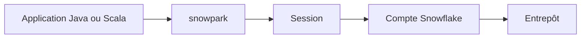

# snowflakedb/snowpark-java-scala

> Snowflake's Java and Scala API for processing data inside Snowflake without moving it out.

## The problem
Processing warehouse data forces you to move it to the machine running the application.

## What it actually does
The library provides query and processing APIs that run inside Snowflake. You open a `Session` with the account parameters (URL, user, role, warehouse, database, schema), then run SQL or DataFrame operations. It is published per Scala version (`snowpark_2.12`, `snowpark_2.13`).

## How it is wired
Simplified diagram based on the fiche, no diagram provided.



## Trying it
```scala
libraryDependencies += "com.snowflake" %% "snowpark" % "1.21.0"

val session = Session.builder.configs(configs).create
session.sql("show tables").show()
```

## Cost and gotchas
You need a Snowflake account (30-day free trial, then Snowflake billing) and Java 11, 17 or 21 with Scala 2.12 or 2.13. Scala 3 is not supported.

## What it is not
It is not a Python library: the Python equivalent is a separate product. Nothing runs without a Snowflake account.

## Alternatives
No alternative named in the README.

## For you
Worth watching: relevant if your warehouse is Snowflake and your team works on the JVM; otherwise, the Python version serves a data profile better.
