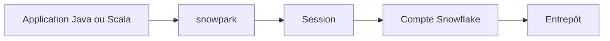

# snowflakedb/snowpark-java-scala

> API Java et Scala de Snowflake pour traiter les données dans Snowflake sans les en sortir.

## Le problème
Traiter des données de l'entrepôt oblige à les déplacer vers la machine qui exécute l'application.

## Ce que ça fait vraiment
La bibliothèque offre des API de requête et de traitement exécutées dans Snowflake. On ouvre une `Session` avec les paramètres du compte (URL, utilisateur, rôle, entrepôt, base, schéma), puis on lance du SQL ou des opérations de DataFrame. Elle est publiée par version de Scala (`snowpark_2.12`, `snowpark_2.13`).

## Comment c'est branché
Schéma simplifié d'après la fiche, sans diagramme fourni.



## Essayer
```scala
libraryDependencies += "com.snowflake" %% "snowpark" % "1.21.0"

val session = Session.builder.configs(configs).create
session.sql("show tables").show()
```

## Coût et pièges
Il faut un compte Snowflake (essai gratuit de 30 jours, puis facturation Snowflake) et Java 11, 17 ou 21 avec Scala 2.12 ou 2.13. Scala 3 n'est pas supporté.

## Ce que ce n'est pas
Ce n'est pas une bibliothèque Python : l'équivalent Python est un autre produit. Rien ne tourne sans compte Snowflake.

## Alternatives
Aucune alternative nommée dans le README.

## Pour toi
À surveiller : pertinent si ton entrepôt est Snowflake et ton équipe en JVM ; sinon, la version Python sert mieux un profil data.

