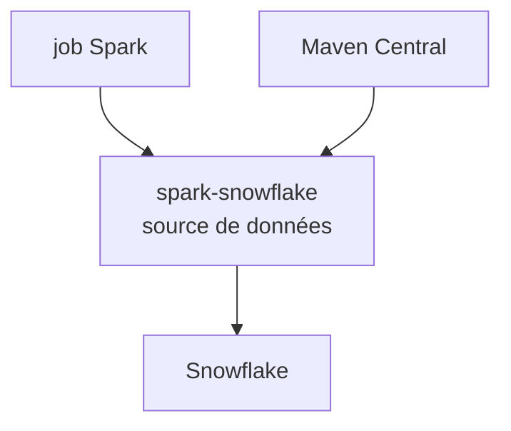

# snowflakedb/spark-snowflake

> Apache Spark connector for reading from and writing to Snowflake, for data engineers.

## The problem
Exchanging data between Spark and Snowflake without an official connector forces intermediate exports.

## What it actually does
A Spark data source for Snowflake. The main branch supports Spark 3.5 and 4.0; tags exist for older versions. Added as the Maven dependency `net.snowflake:spark-snowflake_$SCALA_VERSION:$RELEASE-spark_$SPARKVERSION`. Originated as a fork of spark-redshift. Short README: details are in the official documentation.

## How it is wired
Simplified diagram based on the fiche, no diagram provided.

## Trying it
No command documented in the README, only the shape of the Maven dependency.

## Cost and gotchas
A paid Snowflake account is required. Pick the version aligned with your Spark and Scala.

## What it is not
Not a standalone tool: it plugs into an existing Spark cluster. The full documentation is outside the README.

## Alternatives
Not documented in the README (spark-redshift is mentioned as the origin of the fork).

## For you
Adopt it if you run Spark on Snowflake: a vendor connector, active and maintained; otherwise irrelevant.
