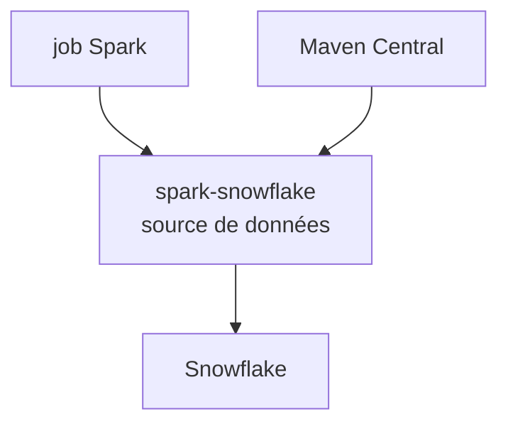

# snowflakedb/spark-snowflake

> Connecteur Apache Spark pour lire et écrire dans Snowflake, pour les ingénieurs data.

## Le problème
Échanger des données entre Spark et Snowflake sans connecteur officiel oblige à des exports intermédiaires.

## Ce que ça fait vraiment
Source de données Spark pour Snowflake. La branche principale gère Spark 3.5 et 4.0 ; des tags existent pour les versions plus anciennes. S'ajoute en dépendance Maven `net.snowflake:spark-snowflake_$SCALA_VERSION:$RELEASE-spark_$SPARKVERSION`. Issu d'un fork de spark-redshift. README court : détails dans la documentation officielle.

## Comment c'est branché
Schéma simplifié d'après la fiche, sans diagramme fourni.

## Essayer
Aucune commande documentée dans le README, seulement la forme de la dépendance Maven.

## Coût et pièges
Compte Snowflake payant requis. Choisir la version alignée sur Spark et Scala.

## Ce que ce n'est pas
Pas un outil autonome : il se greffe à un cluster Spark existant. La documentation complète est hors du README.

## Alternatives
Non documenté dans le README (spark-redshift est cité comme origine du fork).

## Pour toi
À adopter si tu fais du Spark sur Snowflake : connecteur éditeur, actif et maintenu ; sinon sans objet.

