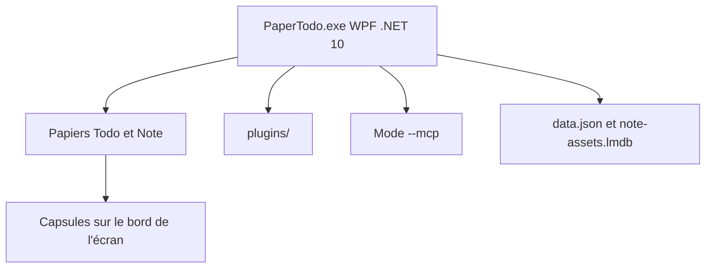

# snownico0722/PaperTodo

> Windows app for notes and to-do lists as papers stuck on the desktop.

## The problem
Task managers impose a heavy management console; here you just want sheets that are always visible on the desktop.

## What it actually does
Two kinds of papers: a to-do list and a Markdown note, each in its own window. Papers fold into capsules stuck to the screen edge, with a preview on hover. A plugin system (clock, Pomodoro), PowerShell script capsules and a `--mcp` mode for AI assistants are in preview. Local data in `data.json` and `note-assets.lmdb`.

## How it is wired
Simplified diagram based on the sheet, no diagram provided.



## Trying it
```bash
git clone --recurse-submodules https://github.com/snownico0722/PaperTodo.git
cd PaperTodo
dotnet build -c Release
git submodule update --init --recursive
```
Otherwise, download the executable from the Releases.

## Cost and gotchas
Free on GitHub, optional purchase on the Microsoft Store. Windows only, .NET 10 to build. License not identified.

## What it is not
Not a project management tool, deliberately. Not cross-platform (WPF). The MCP interface and the plugins are in preview.

## Alternatives
No alternative named in the README.

## For you
Ignore: a Windows desktop tool unrelated to data or MLOps; only the MCP mode is of marginal interest, and it is in preview.
