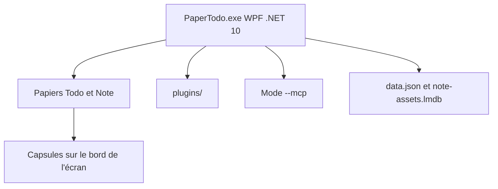

# snownico0722/PaperTodo

> Application Windows de notes et listes de tâches sous forme de papiers collés sur le bureau.

## Le problème
Les gestionnaires de tâches imposent une console de gestion lourde ; ici on veut juste des feuilles toujours visibles sur le bureau.

## Ce que ça fait vraiment
Deux types de papiers : liste de tâches et note Markdown, chacun dans sa propre fenêtre. Les papiers se replient en capsules collées au bord de l'écran, avec aperçu au survol. Un système de plugins (horloge, Pomodoro), des capsules de script PowerShell et un mode `--mcp` pour assistants IA sont en préversion. Données locales dans `data.json` et `note-assets.lmdb`.

## Comment c'est branché
Schéma simplifié d'après la fiche, sans diagramme fourni.



## Essayer
```bash
git clone --recurse-submodules https://github.com/snownico0722/PaperTodo.git
cd PaperTodo
dotnet build -c Release
git submodule update --init --recursive
```
Sinon, télécharger l'exécutable depuis les Releases.

## Coût et pièges
Gratuit sur GitHub, achat optionnel sur le Microsoft Store. Windows seulement, .NET 10 pour compiler. Licence non identifiée.

## Ce que ce n'est pas
Pas un outil de gestion de projet, volontairement. Pas multiplateforme (WPF). L'interface MCP et les plugins sont en préversion.

## Alternatives
Aucune alternative nommée dans le README.

## Pour toi
À ignorer : outil de bureau Windows sans lien avec la data ou le MLOps ; seul le mode MCP intéresse à la marge, et il est en préversion.

