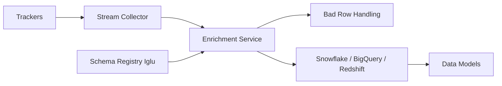

# snowplow/snowplow

> Platform for collecting schema-validated behavioral events into a data warehouse, for data teams.

## The problem
Building your own clean, validated, real-time-enriched event collection is expensive.

## What it actually does
Repository that gathers the Snowplow components as submodules: trackers (web, mobile, server), stream collector, enrichments (more than 15), Iglu schema registry, "bad rows" handling, loading to Snowflake, BigQuery, Redshift, dbt models. The README highlights "Event Studio" and "Signals" for AI agents.

## How it is wired


## Trying it
No command in the README; it points to the documentation and the Developer Hub.

```bash
# non documenté dans le README
```

## Cost and gotchas
Since January 8, 2024, new pipeline versions are under a "Limited Use License": production or competing use is affected; no security fixes before January 2024. The repository is an aggregate of submodules.

## What it is not
Not a turnkey tool: it is infrastructure to deploy. Not fully Apache-2.0 in practice (see license).

## Alternatives
No alternative named in the README.

## For you
Worth watching: useful for reliable behavioral data, but read the "Limited Use" license before adopting it in production.
