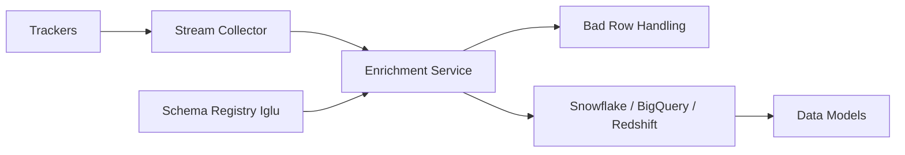

# snowplow/snowplow

> Plateforme de collecte d'événements comportementaux validés par schéma, vers entrepôt de données, pour équipes data.

## Le problème
Construire soi-même une collecte d'événements propre, validée et enrichie en temps réel coûte cher.

## Ce que ça fait vraiment
Dépôt qui regroupe en sous-modules les composants Snowplow : trackers (web, mobile, serveur), collecteur de flux, enrichissements (plus de 15), registre de schémas Iglu, gestion des « bad rows », chargement vers Snowflake, BigQuery, Redshift, modèles dbt. Le README met en avant « Event Studio » et « Signals » pour les agents IA.

## Comment c'est branché


## Essayer
Aucune commande dans le README ; renvoi vers la documentation et le Developer Hub.

```bash
# non documenté dans le README
```

## Coût et pièges
Depuis le 8 janvier 2024, nouvelles versions du pipeline sous « Limited Use License » : usage en production ou concurrent concerné ; pas de correctifs de sécurité avant janvier 2024. Le dépôt est un agrégat de sous-modules.

## Ce que ce n'est pas
Pas un outil clé en main : c'est une infrastructure à déployer. Pas totalement Apache-2.0 en pratique (voir licence).

## Alternatives
Aucune alternative nommée dans le README.

## Pour toi
À surveiller : utile pour des données comportementales fiables, mais lis la licence « Limited Use » avant de l'adopter en production.

