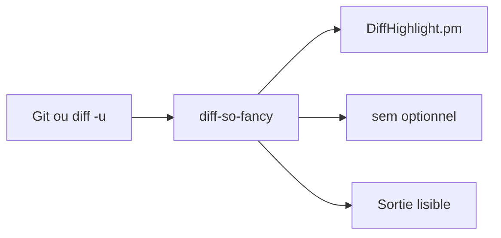

# so-fancy/diff-so-fancy

> Git diff output filter that makes diffs human-readable.

## The problem
The standard `git diff` is dense and hard to review.

## What it actually does
A Perl script copied into your `$PATH` (the `lib/` folder must stay relative) that reformats a unified diff: simplified headers, `+/-` symbols removed, Unicode rules, blank lines marked. Options via `git config diff-so-fancy.*`, including an optional `sem` summary.

## How it is wired


## Trying it
```shell
git config --global core.pager "diff-so-fancy | less --tabs=4 -RF"
git config --global interactive.diffFilter "diff-so-fancy --patch"
diff -u file_a file_b | diff-so-fancy
```

## Cost and gotchas
Free. Installation via release, npm, brew, Fedora, Arch, Debian ppa; packaging issues go to the respective repositories.

## What it is not
Not a merge tool nor a structural code review tool; it does not understand syntax, it formats text.

## Alternatives
Delta: the README lists it, without detail. Lazygit with diff-so-fancy integration. difftastic.

## For you
Worth watching: comfort for reading diffs, with no data/AI stakes; try it in two commands if you review many PRs.
