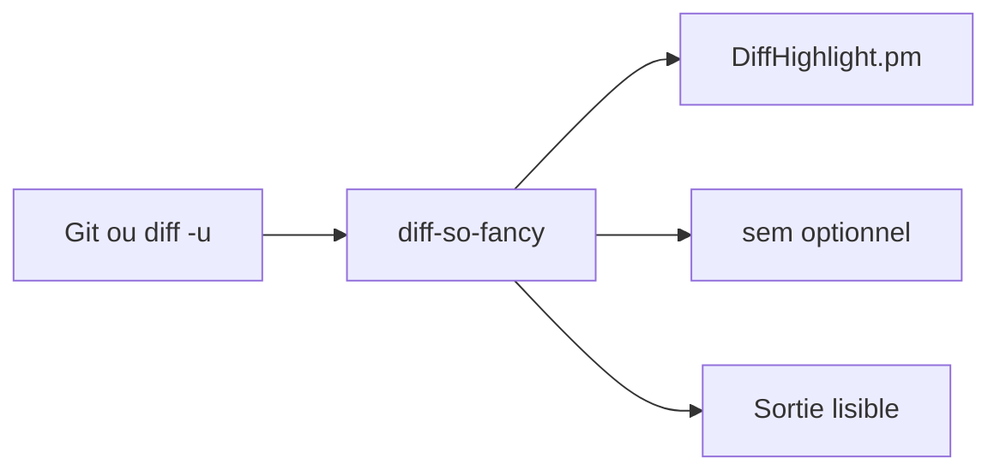

# so-fancy/diff-so-fancy

> Filtre de sortie de diff Git pour rendre les diffs lisibles par un humain.

## Le problème
Le `git diff` standard est dense et difficile à relire.

## Ce que ça fait vraiment
Script Perl copié dans le `$PATH` (le dossier `lib/` doit rester relatif) qui reformate un diff unifié : en-têtes simplifiés, symboles `+/-` retirés, règles Unicode, lignes vides marquées. Options via `git config diff-so-fancy.*`, dont un résumé `sem` optionnel.

## Comment c'est branché


## Essayer
```shell
git config --global core.pager "diff-so-fancy | less --tabs=4 -RF"
git config --global interactive.diffFilter "diff-so-fancy --patch"
diff -u file_a file_b | diff-so-fancy
```

## Coût et pièges
Gratuit. Installation via release, npm, brew, Fedora, Arch, ppa Debian ; les soucis de paquets vont aux dépôts concernés.

## Ce que ce n'est pas
Pas un outil de merge ni de revue structurelle du code ; il ne comprend pas la syntaxe, il met en forme du texte.

## Alternatives
Delta : le README le liste, sans détail. Lazygit avec intégration diff-so-fancy. difftastic.

## Pour toi
Surveiller : confort de relecture de diffs, sans enjeu data/IA ; à tester en deux commandes si tu revois beaucoup de PR.

