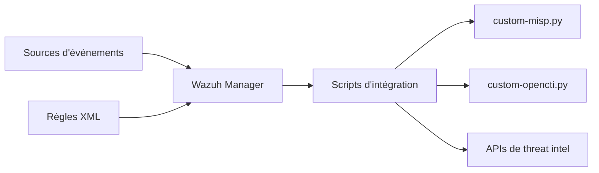

# socfortress/Wazuh-Rules

> Detection rules and integration scripts to flesh out an already deployed Wazuh Manager.

## The problem
The default Wazuh rules are judged by the authors to be too lax to detect recent threats.

## What it actually does
A repository of XML rule files (Sysmon Windows/Linux, Chainsaw, Suricata, Packetbeat...) and enrichment scripts (MISP, OpenCTI, AbuseIPDB, Office 365, Trend Micro, nmap). A bash script copies them onto the manager.

## How it is wired


## Trying it
```bash
curl -so ~/wazuh_socfortress_rules.sh https://raw.githubusercontent.com/socfortress/Wazuh-Rules/main/wazuh_socfortress_rules.sh && bash ~/wazuh_socfortress_rules.sh
```
Run as root, after backing up your rules.

## Cost and gotchas
Wazuh 4.x required. Rule IDs duplicated with your custom rules can make the manager service fail. No license declared: reuse rights are unclear.

## What it is not
Not a SIEM: these are rules for Wazuh. The repository also serves as a commercial showcase for SOCFortress.

## Alternatives
No alternative cited in the README.

## For you
Ignore unless you administer Wazuh: outside the data/AI scope, and the lack of a license hinders any enterprise use.
