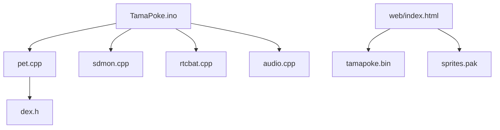

# socquique/TamaPoke

> Firmware for a Pokémon tamagotchi on an ESP32-S3 board with a round screen, a hobby project for tinkerers.

## The problem
None: it is a fan project for raising the 151 first-generation Pokémon on a small device.

## What it actually does
The Arduino firmware handles needs, evolution, eggs by rarity, Pokédex, streaks, medals, ball game, sound, 8 languages and a clock that keeps running while powered off. Sprites come from PMD SpriteCollab, loaded from the microSD card. A web installer flashes the firmware and sends the sprites.

## How it is wired


## Trying it
```bash
FQBN="esp32:esp32:esp32s3:CDCOnBoot=cdc,FlashSize=16M,PSRAM=opi,PartitionScheme=app3M_fat9M_16MB"
arduino-cli compile --fqbn "$FQBN" .
python3 tools/pack_pmd.py
python3 tools/send_sd.py
```

## Cost and gotchas
You need to buy the Waveshare ESP32-S3-Touch-AMOLED-1.75 board (not the -B version), a microSD card and optionally a battery. The code is under MIT but the sprites are CC BY-NC and the 3D case is CC BY-NC-SA: non-commercial use only.

## What it is not
Not a complete game: encounters and battles are designed but not implemented. Non-commercial fan project, Pokémon belongs to Nintendo.

## Alternatives
No alternative named in the README.

## For you
Ignore: an electronic toy, outside any data, AI or MLOps need.
