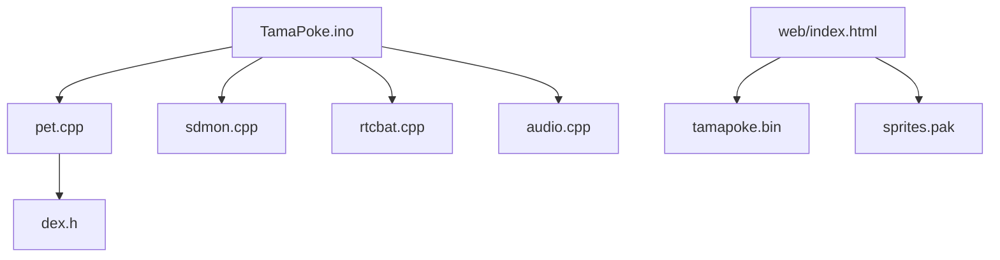

# socquique/TamaPoke

> Micrologiciel d'un tamagotchi Pokémon sur carte ESP32-S3 à écran rond, projet de loisir pour bricoleurs.

## Le problème
Aucun : c'est un projet de fan pour élever les 151 Pokémon de première génération sur un petit appareil.

## Ce que ça fait vraiment
Le firmware Arduino gère besoins, évolution, œufs par rareté, Pokédex, séries, médailles, jeu de balle, son, 8 langues et horloge qui continue hors tension. Les sprites viennent de PMD SpriteCollab, chargés depuis la carte microSD. Un installateur web flashe le firmware et envoie les sprites.

## Comment c'est branché


## Essayer
```bash
FQBN="esp32:esp32:esp32s3:CDCOnBoot=cdc,FlashSize=16M,PSRAM=opi,PartitionScheme=app3M_fat9M_16MB"
arduino-cli compile --fqbn "$FQBN" .
python3 tools/pack_pmd.py
python3 tools/send_sd.py
```

## Coût et pièges
Il faut acheter la carte Waveshare ESP32-S3-Touch-AMOLED-1.75 (pas la version -B), une carte microSD et éventuellement une batterie. Le code est sous MIT mais les sprites sont CC BY-NC, la boîtier 3D CC BY-NC-SA : usage non commercial.

## Ce que ce n'est pas
Pas un jeu complet : les rencontres et combats sont conçus mais pas implémentés. Projet de fan non commercial, Pokémon appartient à Nintendo.

## Alternatives
Aucune alternative nommée dans le README.

## Pour toi
À ignorer : un jouet électronique, hors de tout besoin data, IA ou MLOps.

