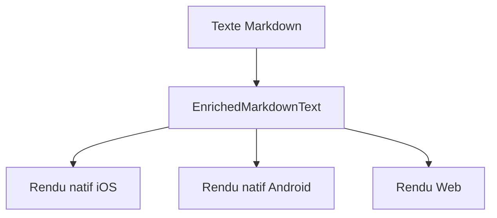

# software-mansion-labs/react-native-enriched-markdown

> SDK to display Markdown as native text and enter rich text, on React Native, iOS and Android.

## The problem
Rendering Markdown through a WebView is slow and not very native, notably for streamed AI conversations.

## What it actually does
Renders Markdown (CommonMark, GFM, LaTeX formulas, tree-sitter highlighting) with the platform's text APIs, without a WebView. Also offers a rich-text input field with Markdown output, streaming for LLM chat interfaces, and VoiceOver and TalkBack accessibility. React Native, Android (Kotlin) and iOS (Swift) packages.

## How it is wired
Simplified diagram based on the sheet, no diagram provided.


## Trying it
```bash
yarn add react-native-enriched-markdown
```
```tsx
<EnrichedMarkdownText
  markdown={"# Hello\n\nThis is **enriched** [markdown](https://commonmark.org)."}
  onLinkPress={({ url }) => Linking.openURL(url)}
/>
```

## Cost and gotchas
Free. A React Native project is required. The repository is a Software Mansion lab with 121 open issues. The identical README exists under `software-mansion/enriched-markdown`.

## What it is not
Not a full Markdown editor nor a file converter: a mobile display and input component.

## Alternatives
No alternative named in the README.

## For you
Keep an eye on it: useful if you are building a mobile LLM chat application with streamed Markdown rendering, otherwise off-topic.
