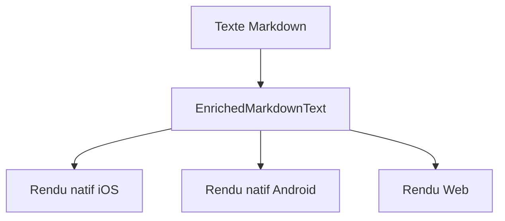

# software-mansion-labs/react-native-enriched-markdown

> SDK pour afficher du Markdown en texte natif et saisir du texte riche, sur React Native, iOS et Android.

## Le problème
Rendre du Markdown via une WebView est lent et peu natif, notamment pour des conversations d'IA en flux.

## Ce que ça fait vraiment
Rend le Markdown (CommonMark, GFM, formules LaTeX, coloration tree-sitter) avec les API texte de la plateforme, sans WebView. Propose aussi un champ de saisie de texte riche avec sortie Markdown, du streaming pour interfaces de chat LLM, et l'accessibilité VoiceOver et TalkBack. Paquets React Native, Android (Kotlin) et iOS (Swift).

## Comment c'est branché
Schéma simplifié d'après la fiche, sans diagramme fourni.


## Essayer
```bash
yarn add react-native-enriched-markdown
```
```tsx
<EnrichedMarkdownText
  markdown={"# Hello\n\nThis is **enriched** [markdown](https://commonmark.org)."}
  onLinkPress={({ url }) => Linking.openURL(url)}
/>
```

## Coût et pièges
Gratuit. Projet React Native requis. Le dépôt est un laboratoire de Software Mansion avec 121 issues ouvertes. Le README identique existe sous `software-mansion/enriched-markdown`.

## Ce que ce n'est pas
Pas un éditeur Markdown complet ni un convertisseur de fichiers : un composant d'affichage et de saisie mobile.

## Alternatives
Aucune alternative nommée dans le README.

## Pour toi
Surveiller : utile si tu construis une application mobile de chat LLM avec rendu Markdown en flux, sinon hors sujet.

