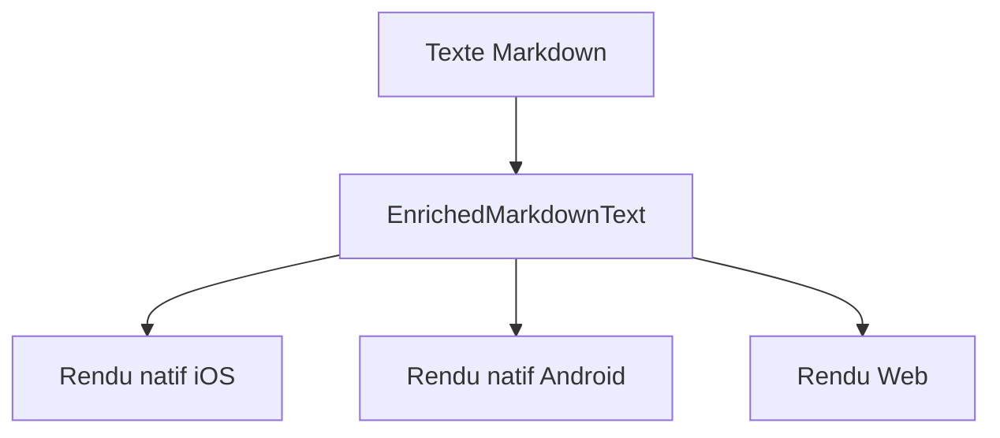

# software-mansion/enriched-markdown

> SDK to display Markdown as native text and enter rich text, on React Native, iOS and Android.

## The problem
Rendering Markdown through a WebView is slow and not very native, notably for streamed AI conversations.

## What it actually does
Same README as `software-mansion-labs/react-native-enriched-markdown` (same stars, issues and last push). Renders Markdown with the platform's text APIs, without a WebView, with LaTeX, tree-sitter highlighting, rich-text input and streaming for LLM chats.

## How it is wired
Simplified diagram based on the sheet, no diagram provided.


## Trying it
```bash
yarn add react-native-enriched-markdown
```

## Cost and gotchas
Free. A React Native project is required. Probable duplicate or redirect of the labs repository: the catalog does not specify.

## What it is not
Not a full Markdown editor: a mobile display and input component.

## Alternatives
No alternative named in the README.

## For you
Keep an eye on it: useful for a mobile LLM chat with streamed Markdown rendering, otherwise off-topic.
