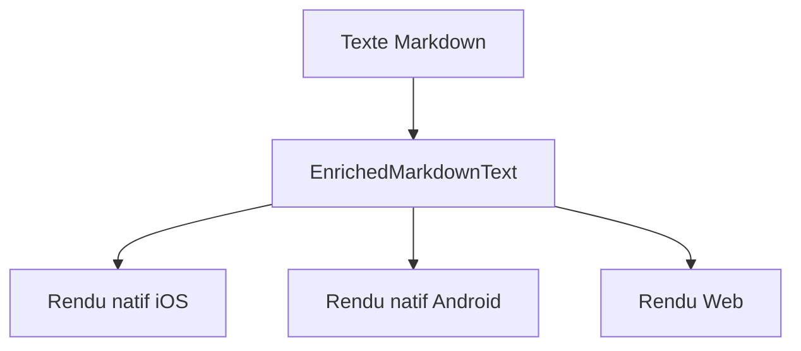

# software-mansion/enriched-markdown

> SDK pour afficher du Markdown en texte natif et saisir du texte riche, sur React Native, iOS et Android.

## Le problème
Rendre du Markdown via une WebView est lent et peu natif, notamment pour des conversations d'IA en flux.

## Ce que ça fait vraiment
Même README que `software-mansion-labs/react-native-enriched-markdown` (mêmes étoiles, issues et dernier push). Rend le Markdown avec les API texte de la plateforme, sans WebView, avec LaTeX, coloration tree-sitter, saisie de texte riche et streaming pour chats LLM.

## Comment c'est branché
Schéma simplifié d'après la fiche, sans diagramme fourni.


## Essayer
```bash
yarn add react-native-enriched-markdown
```

## Coût et pièges
Gratuit. Projet React Native requis. Probable doublon ou redirection du dépôt labs : le catalogue ne le précise pas.

## Ce que ce n'est pas
Pas un éditeur Markdown complet : un composant d'affichage et de saisie mobile.

## Alternatives
Aucune alternative nommée dans le README.

## Pour toi
Surveiller : utile pour un chat LLM mobile avec rendu Markdown en flux, sinon hors sujet.

