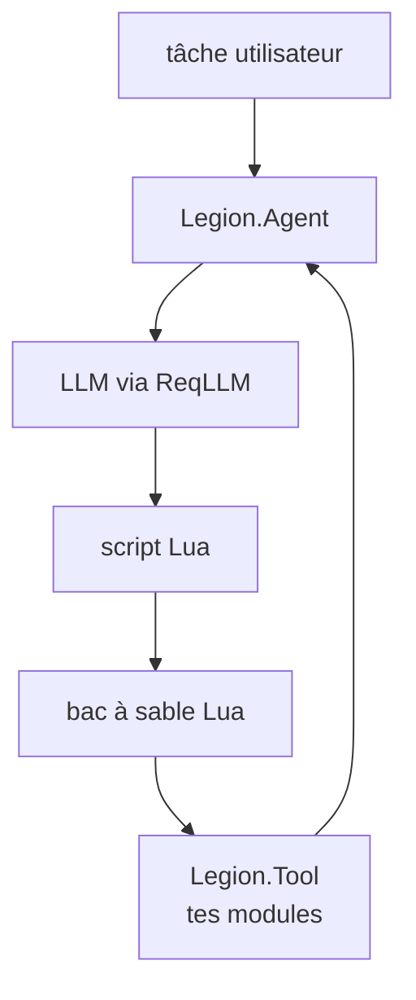

# software-mansion/legion

> Elixir runtime where AI agents write and run Lua scripts in a sandbox, with your modules as tools.

## The problem
An agent that calls one tool at a time costs one LLM round trip per call. Making them loop over your data is heavy.

## What it actually does
You expose modules via `use Legion.Tool`. The agent reads their source, writes a Lua script, runs it in a pure-Elixir Lua VM (time and memory limited) and iterates. Provides sub-agents, Postgres persistence, rate limits, telemetry, and an optional MCP server. Version 0.6. Its README is identical to that of software-mansion-labs/legion.

## How it is wired


## Trying it
```bash
# mix.exs
# {:legion, "~> 0.6"}
# config/runtime.exs
# config :req_llm, openai_api_key: System.get_env("OPENAI_API_KEY")
mix phx.server
```

## Cost and gotchas
LLM provider API key (default OpenAI); local models are possible. Exposed over MCP without authorization, the sandbox is open to anyone who can reach the endpoint.

## What it is not
Not a coding agent: it does not modify your code. Elixir only. Apparent duplicate of software-mansion-labs/legion (same content, same date).

## Alternatives
Not documented in the README.

## For you
Worth watching: same verdict as its twin; the code-instead-of-tool-calls approach deserves a look, but Elixir and version 0.6 hold back adoption.
