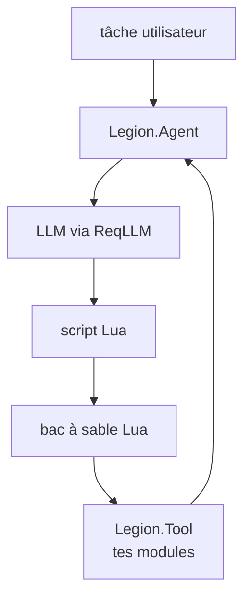

# software-mansion/legion

> Runtime Elixir où des agents IA écrivent et exécutent des scripts Lua dans un bac à sable, avec tes modules comme outils.

## Le problème
Un agent qui appelle un outil à la fois coûte un aller-retour LLM par appel. Les faire boucler sur tes données est lourd.

## Ce que ça fait vraiment
Tu exposes des modules via `use Legion.Tool`. L'agent lit leur source, écrit un script Lua, l'exécute dans une VM Lua en pur Elixir (temps et mémoire limités) et itère. Fournit sous-agents, persistance Postgres, limites de débit, télémétrie, serveur MCP optionnel. Version 0.6. Son README est identique à celui de software-mansion-labs/legion.

## Comment c'est branché


## Essayer
```bash
# mix.exs
# {:legion, "~> 0.6"}
# config/runtime.exs
# config :req_llm, openai_api_key: System.get_env("OPENAI_API_KEY")
mix phx.server
```

## Coût et pièges
Clé d'API du fournisseur LLM (défaut OpenAI) ; modèles locaux possibles. Exposé en MCP sans autorisation, le bac à sable est ouvert à quiconque atteint le point d'accès.

## Ce que ce n'est pas
Pas un agent de codage : il ne modifie pas ton code. Réservé à Elixir. Dépôt en doublon apparent de software-mansion-labs/legion (même contenu, même date).

## Alternatives
Non documenté dans le README.

## Pour toi
À surveiller : même verdict que son jumeau ; l'approche code-plutôt-qu'appels-d'outils vaut un coup d'œil, mais Elixir et la version 0.6 freinent l'adoption.

