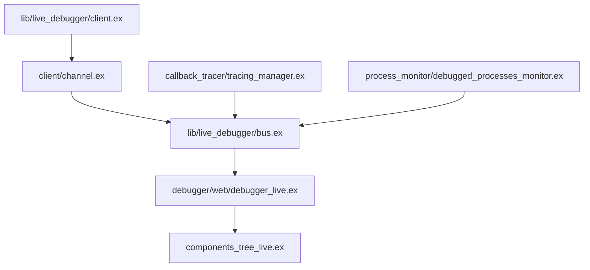

# software-mansion/live-debugger

> In-browser debugger for Phoenix LiveView (Elixir) applications, for development only.

## The problem
Understanding the state and callbacks of a server-side LiveView application is opaque without a dedicated tool.

## What it actually does
Shows the tree of LiveComponents and their assigns, traces and filters callback executions, and lets you inspect elements. A client injected into the application publishes events on an internal bus; the LiveView interface displays them on `localhost:4007`. A DevTools extension exists.

## How it is wired


## Trying it
```bash
mix igniter.install live_debugger
```
Otherwise, add `{:live_debugger, "~> 1.0.0", only: :dev}` to `mix.exs`.

## Cost and gotchas
Free. Must stay a `:dev` dependency: the README forbids production use. Requires an Elixir / Phoenix project.

## What it is not
Not a production observability tool. Useless outside Phoenix LiveView.

## Alternatives
No alternative named in the README.

## For you
Outside the data / AI / MLOps scope (Elixir ecosystem): ignore.
