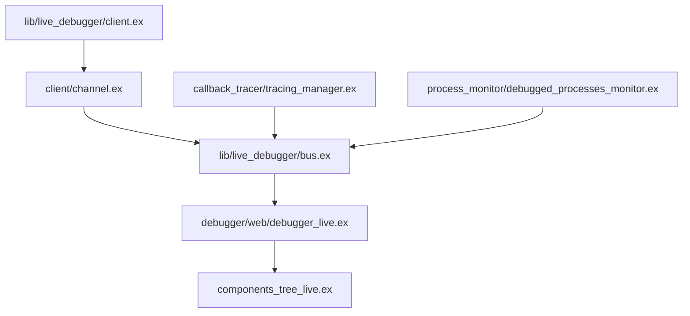

# software-mansion/live-debugger

> Débogueur dans le navigateur pour applications Phoenix LiveView (Elixir), réservé au développement.

## Le problème
Comprendre l'état et les callbacks d'une application LiveView côté serveur est opaque sans outil dédié.

## Ce que ça fait vraiment
Affiche l'arbre des LiveComponents, les assigns, trace et filtre les exécutions de callbacks, et permet d'inspecter les éléments. Un client injecté dans l'application publie des événements sur un bus interne ; l'interface LiveView les affiche sur `localhost:4007`. Une extension DevTools existe.

## Comment c'est branché


## Essayer
```bash
mix igniter.install live_debugger
```
Sinon, ajouter `{:live_debugger, "~> 1.0.0", only: :dev}` dans `mix.exs`.

## Coût et pièges
Gratuit. Doit rester en dépendance `:dev` : le README interdit la production. Demande un projet Elixir / Phoenix.

## Ce que ce n'est pas
Pas un outil d'observabilité de production. Ne sert à rien hors Phoenix LiveView.

## Alternatives
Aucune alternative nommée dans le README.

## Pour toi
Hors périmètre data / IA / MLOps (écosystème Elixir) : à ignorer.

