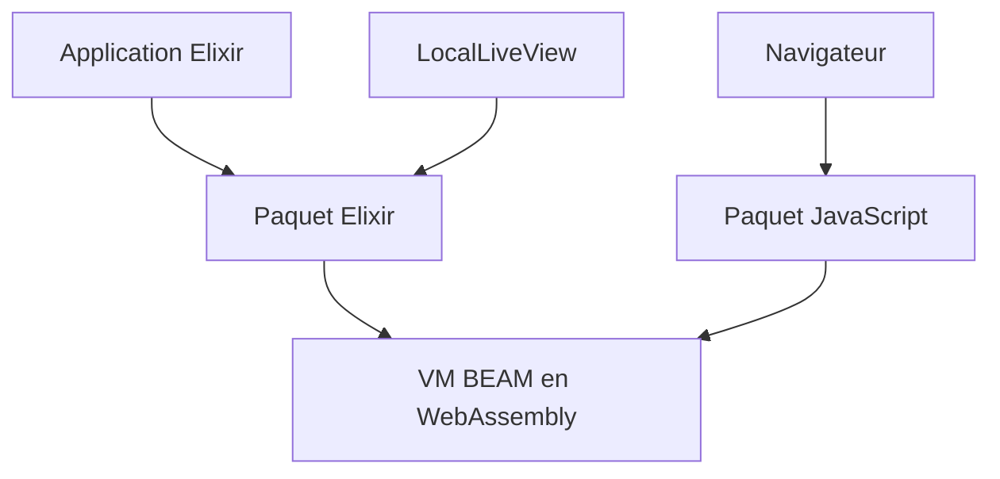

# software-mansion/popcorn

> Runs Elixir and Erlang applications in the browser, on a BEAM virtual machine compiled to WebAssembly.

## The problem
Running Elixir on the client side normally requires a server; here the application runs on the user's device.

## What it actually does
A BEAM VM in WebAssembly with OTP processes, message passing and supervision. JavaScript and Elixir communicate through the Popcorn APIs. LocalLiveView runs Phoenix LiveView in the browser; demos and a tour of the Elixir language run on Popcorn.

## How it is wired
Simplified diagram based on the sheet, no diagram provided.

## Trying it
No command documented in the README: the Hello Popcorn example and the 1.0 documentation give the instructions. Tools are managed by mise (mise.toml).

## Cost and gotchas
Free. You need Elixir, Node and a bundler. Installation details are in the documentation, not in the README.

## What it is not
Not a way to run Python or inference code: it is reserved for the BEAM platform. No announced support beyond the browser.

## Alternatives
No alternative cited in the README.

## For you
Keep an eye on it: interesting for interactive demos without a backend in Elixir, with no direct relevance for a data or MLOps profile.
