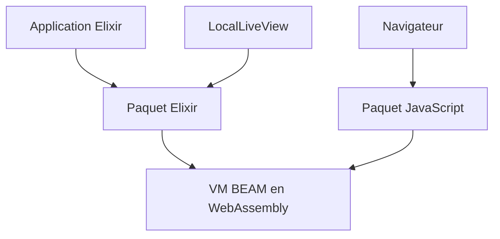

# software-mansion/popcorn

> Exécute des applications Elixir et Erlang dans le navigateur, sur une machine virtuelle BEAM compilée en WebAssembly.

## Le problème
Faire tourner de l'Elixir côté client demande normalement un serveur ; ici l'application s'exécute sur l'appareil de l'utilisateur.

## Ce que ça fait vraiment
Une VM BEAM en WebAssembly avec processus OTP, passage de messages et supervision. JavaScript et Elixir communiquent par les API de Popcorn. LocalLiveView exécute Phoenix LiveView dans le navigateur ; des démonstrations et un tour du langage Elixir tournent sur Popcorn.

## Comment c'est branché
Schéma simplifié d'après la fiche, sans diagramme fourni.

## Essayer
Aucune commande documentée dans le README : l'exemple Hello Popcorn et la documentation 1.0 donnent les instructions. Les outils sont gérés par mise (mise.toml).

## Coût et pièges
Gratuit. Il faut Elixir, Node et un bundler. Les détails d'installation sont dans la documentation et non dans le README.

## Ce que ce n'est pas
Pas une façon de lancer du Python ou du code d'inférence : c'est réservé à la plateforme BEAM. Pas de support annoncé au-delà du navigateur.

## Alternatives
Aucune alternative citée dans le README.

## Pour toi
Surveiller : intéressant pour des démos interactives sans backend en Elixir, sans portée directe pour un profil data ou MLOps.

