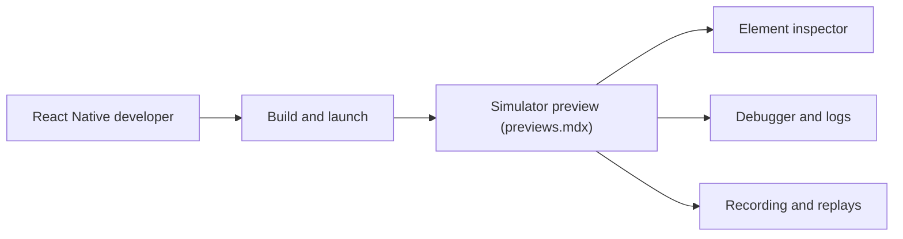

# software-mansion/radon-ide

> VSCode and Cursor extension that turns an editor into an IDE for React Native and Expo applications.

## The problem
Developing in React Native forces you to juggle simulator, inspector, debugger and console.

## What it actually does
- Builds and launches the project, with a simulator preview in the editor.
- Element inspector, debugger tied to the code, log console, device settings, screen recording.
- Component preview; the graph's component list also mentions network inspector, Storybook, Maestro and Radon AI.
- This repository is only for issue tracking and discussions: the code is not here.

## How it is wired

## Trying it
No documented command: install from the VSCode, Cursor or Windsurf marketplace.

## Cost and gotchas
The README does not mention pricing. License present but unidentified; 142 open issues. The source code cannot be browsed here.

## What it is not
Not a framework nor open code auditable from this repository.

## Alternatives
No alternative named in the README.

## For you
Ignore: a mobile development tool, unrelated to data/AI/MLOps.
