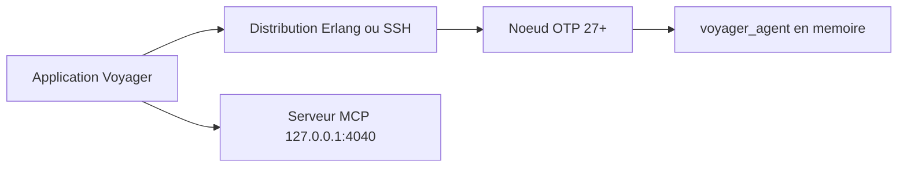

# software-mansion/voyager

> Desktop application that inspects a running BEAM node and exposes the data through MCP.

## The problem
Inspecting an Erlang or Elixir system in production forces you to chain commands copied into `iex`.

## What it actually does
Connects to an OTP 27+ node through Erlang distribution, directly or via an SSH tunnel. Displays node info, supervision trees, process ranking and ETS tables. It loads a small `voyager_agent` module into memory on the node, writing nothing to its disk. A local MCP server serves the same data to coding agents.

## How it is wired
Simplified diagram based on the sheet, no diagram provided.



## Trying it
```bash
iex --name my_app@127.0.0.1 --cookie my-secret-cookie
mix setup
mix phx.server
```

## Cost and gotchas
Free. macOS (Apple Silicon and Intel) and Linux x64 binaries only. The target node must be named, have a cookie and run on OTP 27 or higher. The MCP server is enabled by default, locally.

## What it is not
Not a general-purpose monitoring tool: it targets the BEAM. The license is not recognized by GitHub.

## Alternatives
No alternative named in the README.

## For you
Watch: of no interest if you do not use Erlang or Elixir, but the idea of exposing a live system to an agent through MCP is worth a look.
