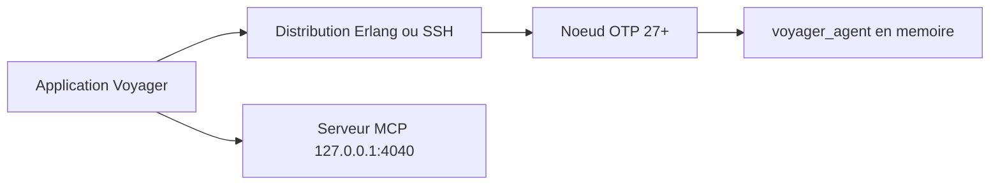

# software-mansion/voyager

> Application de bureau qui inspecte un nœud BEAM en marche et expose les données par MCP.

## Le problème
Inspecter un système Erlang ou Elixir en production oblige à enchaîner des commandes copiées dans `iex`.

## Ce que ça fait vraiment
Se connecte à un nœud OTP 27+ par distribution Erlang, directement ou via tunnel SSH. Affiche infos du nœud, arbres de supervision, classement des processus et tables ETS. Il charge en mémoire un petit module `voyager_agent` sur le nœud, sans rien écrire sur son disque. Un serveur MCP local sert les mêmes données aux agents de code.

## Comment c'est branché
Schéma simplifié d'après la fiche, sans diagramme fourni.



## Essayer
```bash
iex --name my_app@127.0.0.1 --cookie my-secret-cookie
mix setup
mix phx.server
```

## Coût et pièges
Gratuit. Binaires macOS (Apple Silicon et Intel) et Linux x64 seulement. Le nœud cible doit être nommé, avoir un cookie et tourner sous OTP 27 ou plus. Le serveur MCP est activé par défaut, en local.

## Ce que ce n'est pas
Pas un outil généraliste de supervision : il vise la BEAM. La licence n'est pas reconnue par GitHub.

## Alternatives
Aucune alternative nommée dans le README.

## Pour toi
Surveiller : sans intérêt si tu n'utilises pas Erlang ou Elixir, mais l'idée d'exposer un système vivant à un agent par MCP vaut un coup d'œil.

