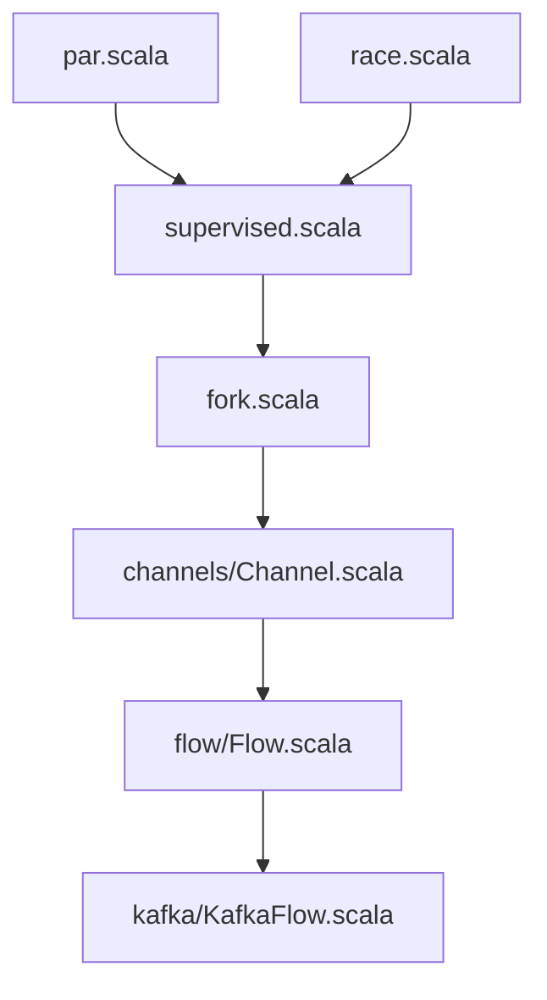

# softwaremill/ox

> Scala 3 library for structured concurrency, streaming and resilience in direct style, on the JVM.

## The problem
Concurrent programming on the JVM mixes callbacks, monads and thread leaks.

## What it actually does
Provides `par`, `race`, `timeout`, supervised scopes with forks, Go-style channels, streaming flows, retry, circuit breaker, rate limiter, actors and a Kafka module. The code stays in direct style.

## How it is wired


## Trying it
```bash
# Dépendance sbt (pas de commande shell) :
# "com.softwaremill.ox" %% "core" % "1.1.0"
# scala-cli : //> using dep "com.softwaremill.ox::core:1.1.0"
```

## Cost and gotchas
Scala 3 and JDK 21 or later, outside the standard prerequisites list. Apache-2.0.

## What it is not
Not a web or data framework. It only concerns the JVM and Scala 3.

## Alternatives
- gears (experimental multi-platform direct-style Scala project).

## For you
Ignore: relevant only if you write Scala on the JVM, for example around Kafka.
