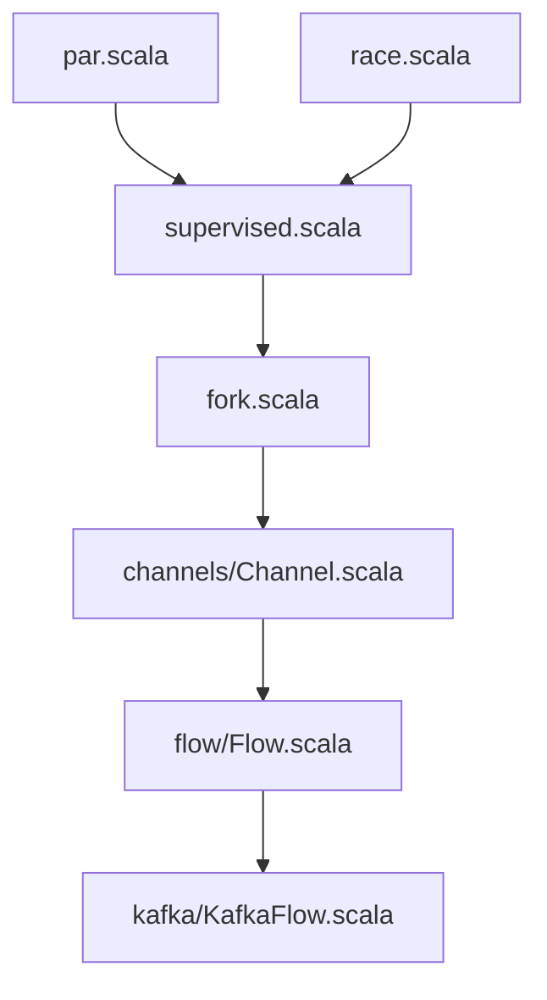

# softwaremill/ox

> Bibliothèque Scala 3 de concurrence structurée, streaming et résilience en style direct, sur JVM.

## Le problème
La programmation concurrente sur la JVM mêle callbacks, monades et fuites de threads.

## Ce que ça fait vraiment
Fournit `par`, `race`, `timeout`, scopes supervisés avec forks, canaux à la Go, flows de streaming, retry, circuit breaker, rate limiter, acteurs et module Kafka. Le code reste en style direct.

## Comment c'est branché


## Essayer
```bash
# Dépendance sbt (pas de commande shell) :
# "com.softwaremill.ox" %% "core" % "1.1.0"
# scala-cli : //> using dep "com.softwaremill.ox::core:1.1.0"
```

## Coût et pièges
Scala 3 et JDK 21 ou plus, hors liste de prérequis standard. Apache-2.0.

## Ce que ce n'est pas
Pas un framework web ni de données. Il ne concerne que la JVM et Scala 3.

## Alternatives
- gears (projet expérimental de Scala direct multi-plateforme).

## Pour toi
À ignorer : pertinent seulement si tu écris du Scala sur la JVM, par exemple autour de Kafka.

