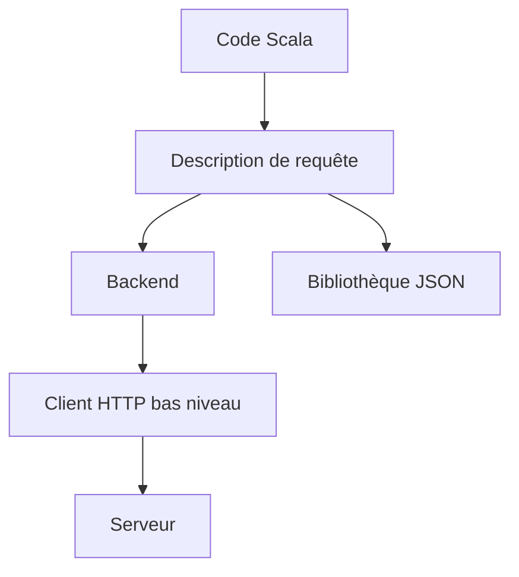

# softwaremill/sttp

> HTTP client for Scala, in direct style, Future or functional effects, for Scala developers.

## The problem
Java HTTP clients are verbose and do not integrate cleanly with Scala effects; resources leak on errors.

## What it actually does
An API to describe requests and responses (URI interpolation, typed errors), with interchangeable backends (Java HttpClient, Akka HTTP, Pekko HTTP, http4s, OkHttp, Armeria). Handles JSON, files, forms, multipart, WebSockets, streaming and metrics. Scala 2.12, 2.13 and 3 on the JVM, Scala.JS and Scala Native.

## How it is wired
Simplified diagram based on the sheet, no diagram provided.


## Trying it
```bash
STTP_NATIVE=1 sbt
```
sbt dependency: `"com.softwaremill.sttp.client4" %% "core" % "4.1.1"`. In scala-cli: `//> using dep com.softwaremill.sttp.client4::core:4.1.1`.

## Cost and gotchas
Free. Java 11+ for Scala 2, Java 17+ for Scala 3. The Native backend is not in the default aggregated build.

## What it is not
Not a client for Python nor a server framework: sttp tapir is a different project.

## Alternatives
No alternative named in the README.

## For you
Ignore: library reserved for the Scala ecosystem, useful only if you write Spark or services in Scala.
