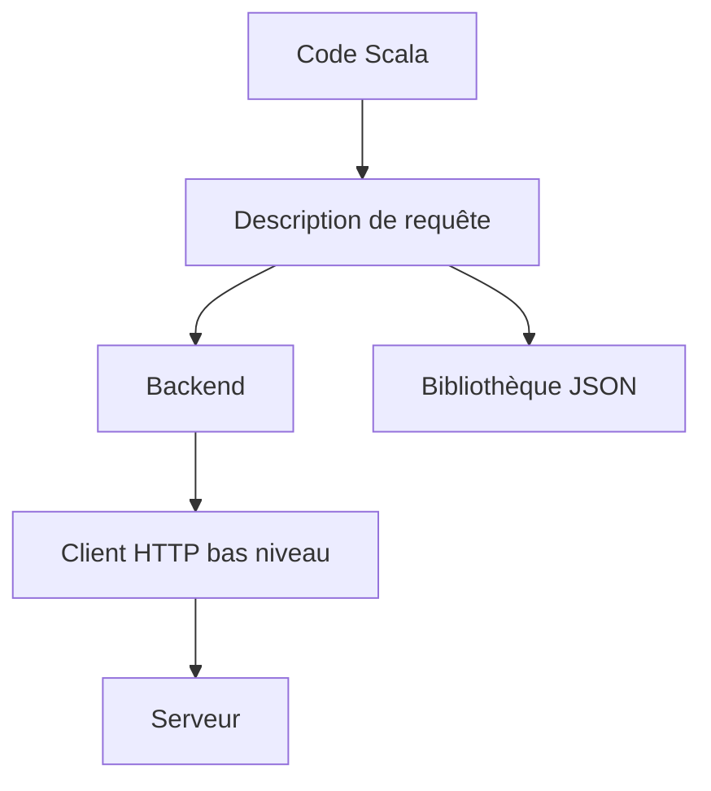

# softwaremill/sttp

> Client HTTP pour Scala, en style direct, Future ou effets fonctionnels, pour développeurs Scala.

## Le problème
Les clients HTTP Java sont verbeux et ne s'intègrent pas proprement aux effets Scala ; les ressources fuient en cas d'erreur.

## Ce que ça fait vraiment
Une API pour décrire requêtes et réponses (interpolation d'URI, erreurs typées), avec des backends interchangeables (HttpClient Java, Akka HTTP, Pekko HTTP, http4s, OkHttp, Armeria). Gère JSON, fichiers, formulaires, multipart, WebSockets, streaming et métriques. Scala 2.12, 2.13 et 3 sur JVM, Scala.JS et Scala Native.

## Comment c'est branché
Schéma simplifié d'après la fiche, sans diagramme fourni.


## Essayer
```bash
STTP_NATIVE=1 sbt
```
Dépendance sbt : `"com.softwaremill.sttp.client4" %% "core" % "4.1.1"`. Dans scala-cli : `//> using dep com.softwaremill.sttp.client4::core:4.1.1`.

## Coût et pièges
Gratuit. Java 11+ pour Scala 2, Java 17+ pour Scala 3. Le backend Native n'est pas dans le build agrégé par défaut.

## Ce que ce n'est pas
Ce n'est pas un client pour Python ni un framework de serveur : sttp tapir est un autre projet.

## Alternatives
Aucune alternative nommée dans le README.

## Pour toi
À ignorer : bibliothèque réservée à l'écosystème Scala, utile seulement si tu écris du Spark ou des services en Scala.

