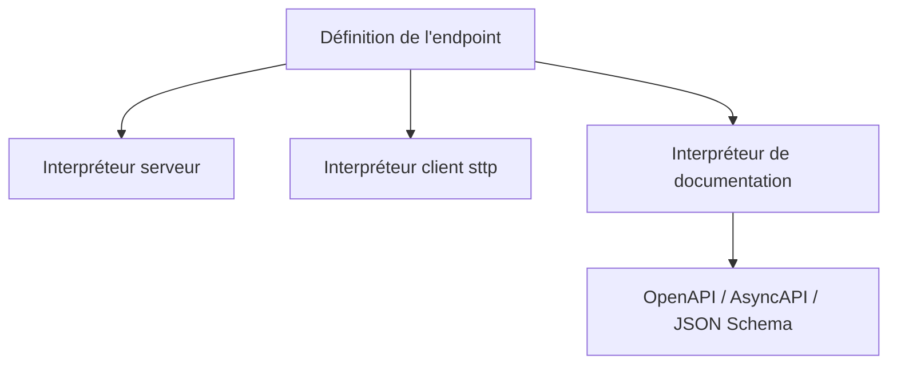

# softwaremill/tapir

> Scala library to describe HTTP APIs, turn them into a server or a client, and generate the documentation.

## The problem
Describing an API by hand for the server, the client and the OpenAPI documentation produces three versions that drift apart.

## What it actually does
You define a typed endpoint (path, parameters, headers, body) once. Interpreters turn it into a route for the usual Scala servers (akka-http, Netty, etc.), into an sttp request on the client side, and into OpenAPI, AsyncAPI or JSON Schema documentation. Integrations cover JSON libraries and observability. The version cited is 1.14.1.

## How it is wired
Simplified diagram based on the sheet, no diagram provided.



## Trying it
```sbt
"com.softwaremill.sttp.tapir" %% "tapir-core" % "1.14.1"
```
```scala
import sttp.tapir._
```

## Cost and gotchas
Free. In Scala 2.12 you must enable `-Ypartial-unification` and sometimes increase the stack (`sbt -J-Xss4M`). Multi-module JS tests exhaust memory.

## What it is not
Not a framework: a library that plugs into your stack. It is only useful within the Scala ecosystem.

## Alternatives
No alternative named in the README.

## For you
Ignore: reserved for Scala teams building HTTP APIs; a Python data / AI / MLOps profile has no use for it.
