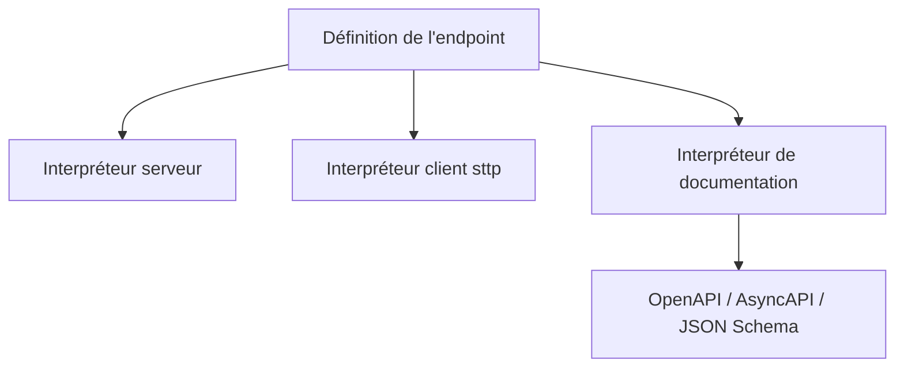

# softwaremill/tapir

> Bibliothèque Scala pour décrire des API HTTP, en faire un serveur ou un client, et générer la documentation.

## Le problème
Décrire une API à la main pour le serveur, le client et la documentation OpenAPI produit trois versions qui divergent.

## Ce que ça fait vraiment
On définit un endpoint typé (chemin, paramètres, en-têtes, corps) une seule fois. Des interpréteurs le transforment en route pour les serveurs Scala usuels (akka-http, Netty, etc.), en requête sttp côté client, et en documentation OpenAPI, AsyncAPI ou JSON Schema. Des intégrations couvrent les bibliothèques JSON et l'observabilité. La version citée est la 1.14.1.

## Comment c'est branché
Schéma simplifié d'après la fiche, sans diagramme fourni.



## Essayer
```sbt
"com.softwaremill.sttp.tapir" %% "tapir-core" % "1.14.1"
```
```scala
import sttp.tapir._
```

## Coût et pièges
Gratuit. En Scala 2.12, il faut activer `-Ypartial-unification` et parfois augmenter la pile (`sbt -J-Xss4M`). Les tests JS multi-modules saturent la mémoire.

## Ce que ce n'est pas
Pas un framework : une bibliothèque qui se greffe sur ta pile. Elle ne sert que dans l'écosystème Scala.

## Alternatives
Aucune alternative nommée dans le README.

## Pour toi
À ignorer : réservé aux équipes Scala qui construisent des API HTTP ; un profil data / IA / MLOps en Python n'en a pas l'usage.

