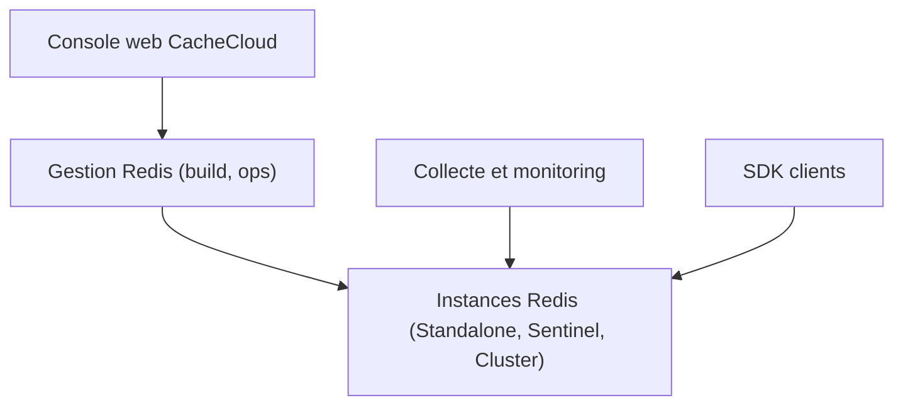

# sohutv/cachecloud

> Redis cluster management platform (Standalone, Sentinel, Cluster) for large-scale operations teams.

## The problem
Running hundreds of Redis instances by hand is expensive in operations and resource tracking.

## What it actually does
According to the README (in Chinese, very short): Redis deployment and migration, host and resource management, auditing, monitoring and alerts, client integration via SDK, elastic resizing. Scale cited: 80 billion commands per day, 4,800 instances. Installation details: not documented here.

## How it is wired

Diagram inferred from the listed features; no diagram provided.

## Trying it
No command documented in the provided README.

## Cost and gotchas
No cost announced. Installation documentation absent from the material read; contact through QQ and WeChat groups.

## What it is not
Not a cache itself: it administers existing or new Redis instances. Not relevant to AI workloads.

## Alternatives
No alternative named in the README.

## For you
Ignore: a Redis operations tool unrelated to data/AI, and the README is too thin to judge the installation.
