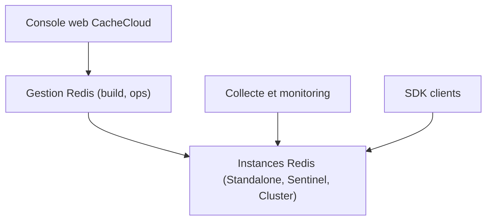

# sohutv/cachecloud

> Plateforme de gestion de clusters Redis (Standalone, Sentinel, Cluster) pour équipes d'exploitation à grande échelle.

## Le problème
Exploiter des centaines d'instances Redis à la main coûte cher en opérations et en suivi de ressources.

## Ce que ça fait vraiment
D'après le README (en chinois, très court) : déploiement et migration de Redis, gestion d'hôtes et de ressources, audit, supervision et alertes, intégration de clients via SDK, redimensionnement élastique. Échelle citée : 80 milliards de commandes par jour, 4 800 instances. Détails d'installation : non documenté ici.

## Comment c'est branché

Schéma déduit des fonctions listées ; aucun diagramme fourni.

## Essayer
Aucune commande documentée dans le README fourni.

## Coût et pièges
Aucun coût annoncé. Documentation d'installation absente de la matière lue ; contact par groupes QQ et WeChat.

## Ce que ce n'est pas
Pas un cache en soi : il administre des Redis existants ou à créer. Ne concerne pas les workloads IA.

## Alternatives
Aucune alternative nommée dans le README.

## Pour toi
Ignorer : outil d'exploitation Redis sans lien avec la data/IA, et README trop mince pour juger l'installation.

