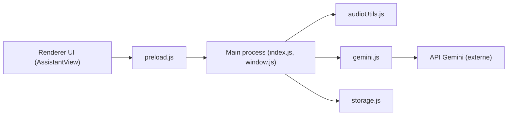

# sohzm/cheating-daddy

> Transparent overlay AI assistant that answers live during interviews, calls and meetings.

## The problem
Answering questions on the spot during a video call, without leaving the screen.

## What it actually does
Electron application: captures the screen and audio (SystemAudioDump on macOS, loopback audio on Windows, microphone on Linux) and sends them to Gemini 2.0 Flash Live, which returns answers displayed in an always-on-top window that can be moved and clicked through. Profiles: interview, sales call, meeting, presentation, negotiation. No server in the repo.

## How it is wired


## Trying it
```bash
npm install
npm start
```

## Cost and gotchas
Gemini key required (Google AI Studio). Screen-recording and microphone permissions. Linux: "do not use, just for testing", according to the README. During testing, the assistant does not answer your own question: you have to simulate the other party.

## What it is not
Not a transcription or meeting-archiving tool. Its main described use (helping during an interview without the other party knowing) raises an honesty issue and conflicts with interview rules.

## Alternatives
No alternative named in the README (Recall.ai, a sponsor, is a recording API).

## For you
Ignore: ethically dubious use, dependence on a third-party API, and an experimental one-person project.
