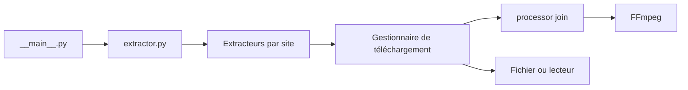

# soimort/you-get

> Small command-line utility to download videos, audio and images from the web.

## The problem
Getting a piece of online media when the site offers no download option.

## What it actually does
It extracts the streams of a site (YouTube, Youku, Niconico…), picks the format (`--itag`), downloads, merges the pieces via FFmpeg, can play in a player (`-p`), resumes a download, uses proxy and cookies, and outputs the URL list or JSON. The code shows per-site extractors, a download manager and FLV, MP4 and TS processors.

## How it is wired


## Trying it
```bash
pip install you-get
you-get 'https://www.youtube.com/watch?v=jNQXAC9IVRw'
you-get -i 'https://www.youtube.com/watch?v=jNQXAC9IVRw'
you-get -o ~/Videos -O zoo.webm 'https://www.youtube.com/watch?v=jNQXAC9IVRw'
```

## Cost and gotchas
Free. FFmpeg is required for merging and for high YouTube resolutions. The README says sites break "all the time". A license is present but not identified by GitHub, while the README mentions MIT.

## What it is not
It is not a right to download: the README leaves responsibility to the user. The generic scraping mode is described as experimental.

## Alternatives
No alternative named in the README.

## For you
Watch: can be used to build an audio or video corpus, but check the sites' terms of use before any serious use.
