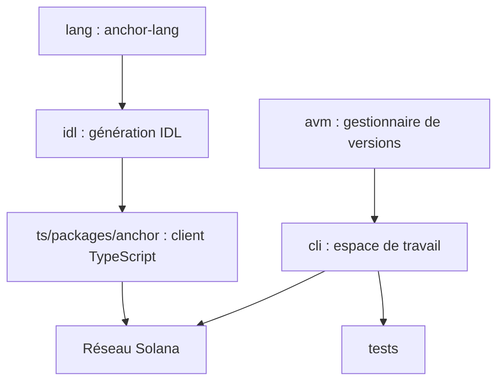

# solana-foundation/anchor

> Rust framework, IDL and CLI to write, test and deploy Solana programs, for blockchain developers.

## The problem
Writing a "bare" Solana program means handling accounts, checks and clients by hand.

## What it actually does
Anchor provides an embedded Rust language (`anchor-lang`), CPI clients (`anchor-spl`), a Rust client and a TypeScript package generated from the IDL, and a workspace management CLI. An `anchor fuzz` command adds coverage-guided fuzzing through Crucible.

## How it is wired


## Trying it
```bash
curl -sSfL https://raw.githubusercontent.com/otter-sec/anchor/master/avm/install | sh
avm nightly
anchor fuzz init program_name
anchor fuzz run program_name test_name --release
```

## Cost and gotchas
Free, but a deployed program costs network fees. The README's installation script is downloaded from the `otter-sec/anchor` repository and installs a nightly version: read it before running it.

## What it is not
Not a data science tool nor an Ethereum smart contract tool, even though the README draws an analogy with Solidity. It does not replace a security audit.

## Alternatives
No alternative cited in the README (analogy with Truffle and web3.js).

## For you
Ignore: blockchain contract development, unrelated to data, AI or MLOps pipelines.
