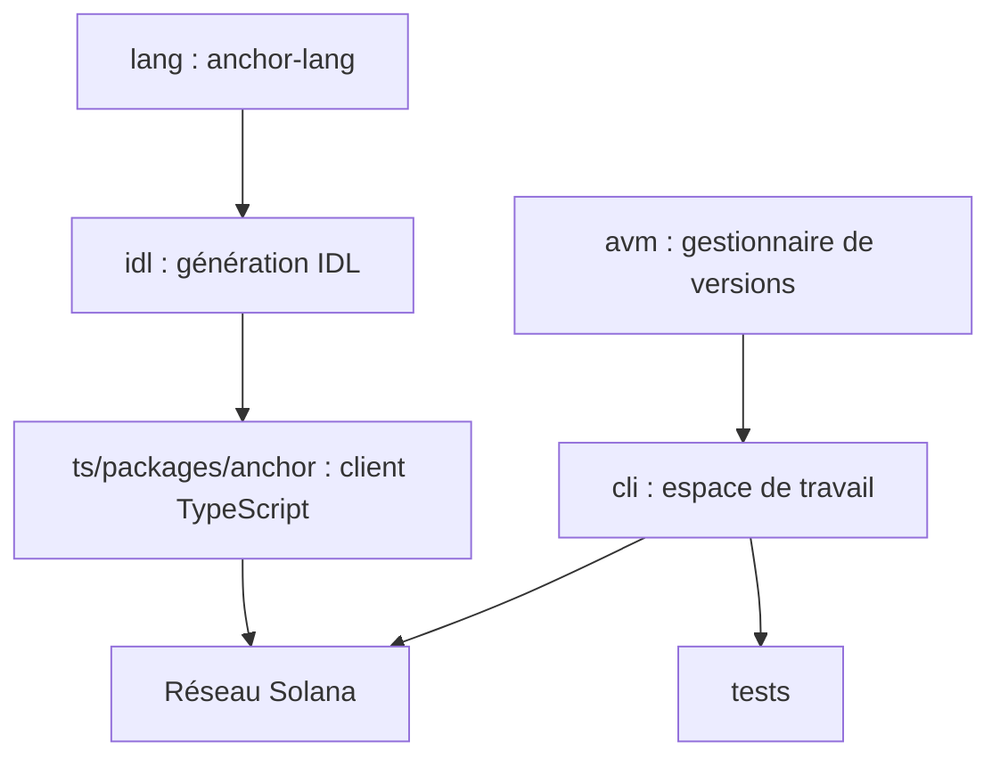

# solana-foundation/anchor

> Framework Rust, IDL et CLI pour écrire, tester et déployer des programmes Solana, pour développeurs blockchain.

## Le problème
Écrire un programme Solana « à nu » impose de gérer à la main les comptes, les vérifications et les clients.

## Ce que ça fait vraiment
Anchor fournit un langage embarqué en Rust (`anchor-lang`), des clients CPI (`anchor-spl`), un client Rust et un paquet TypeScript générés à partir de l'IDL, et une CLI de gestion d'espace de travail. Une commande `anchor fuzz` ajoute du fuzzing guidé par la couverture via Crucible.

## Comment c'est branché


## Essayer
```bash
curl -sSfL https://raw.githubusercontent.com/otter-sec/anchor/master/avm/install | sh
avm nightly
anchor fuzz init program_name
anchor fuzz run program_name test_name --release
```

## Coût et pièges
Gratuit, mais un programme déployé coûte des frais de réseau. Le script d'installation du README est téléchargé depuis le dépôt `otter-sec/anchor` et installe une version nightly : à relire avant de l'exécuter.

## Ce que ce n'est pas
Pas un outil de data science ni de smart contracts Ethereum, même si le README évoque une analogie avec Solidity. Il ne dispense pas d'un audit de sécurité.

## Alternatives
Aucune alternative citée dans le README (analogie avec Truffle et web3.js).

## Pour toi
À ignorer : développement de contrats blockchain, sans rapport avec les pipelines data, IA ou MLOps.

