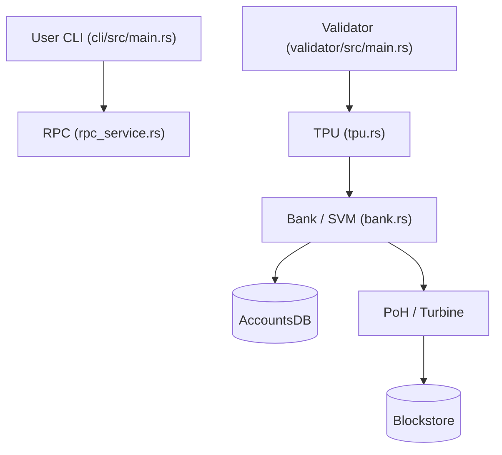

# solana-labs/solana

> Archived reference implementation of the Solana blockchain validator in Rust, replaced by Agave.

## The problem
Running a node of the Solana blockchain required a validator, a client and deployment tools.

## What it actually does
A Rust workspace: validator (TPU, TVU, gossip, RPC), Bank/SVM runtime, AccountsDB, Blockstore ledger, Proof of History and Turbine, client CLI, SDK, native programs, InfluxDB/Grafana metrics, optional Bigtable archiving.

## How it is wired


## Trying it
```bash
git clone https://github.com/solana-labs/solana.git
cd solana
./cargo build
./cargo test
```

## Cost and gotchas
Free. Requires Rust (rustup), OpenSSL, protobuf and system packages depending on the distribution. Archived repository: the successor is Agave. US sanctions disclaimer.

## What it is not
Not maintained. Not investment advice, the README says so.

## Alternatives
Agave, the validator from the company Anza, named by the README as the successor.

## For you
Ignore: archived and outside the data / AI / MLOps scope; if Solana interests you, start from Agave.
