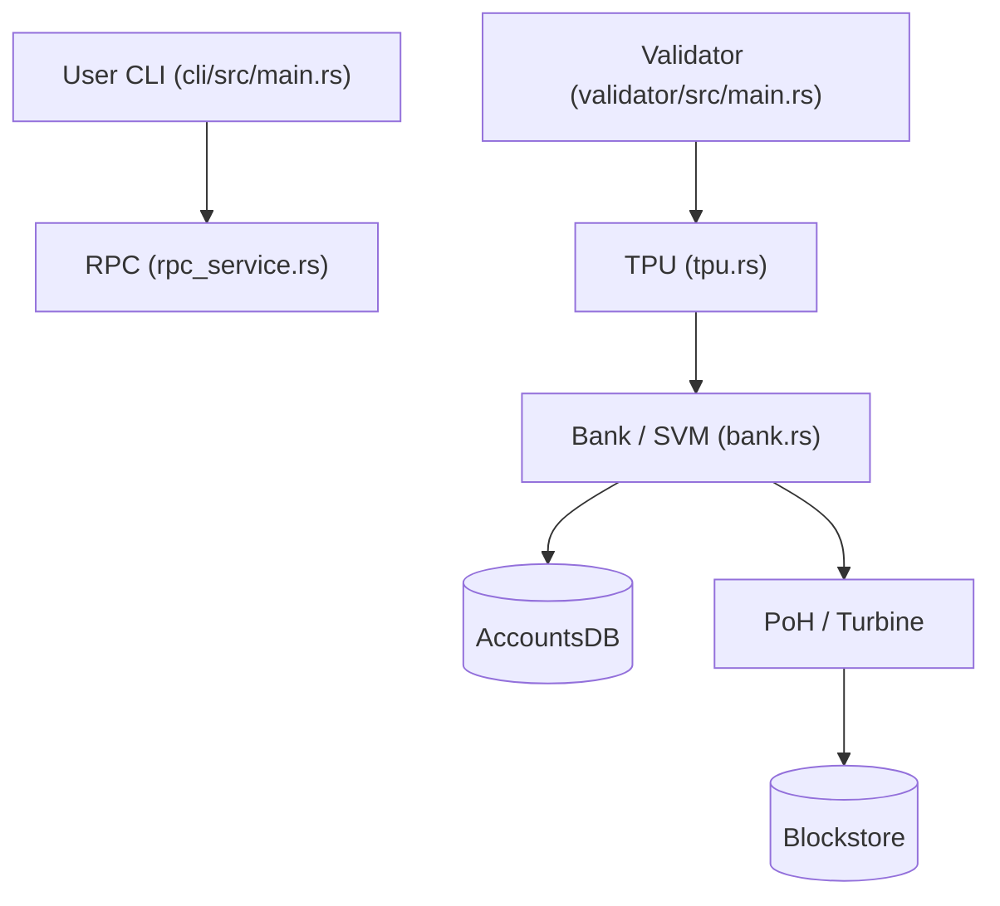

# solana-labs/solana

> Implémentation de référence archivée du validateur blockchain Solana en Rust, remplacée par Agave.

## Le problème
Faire tourner un nœud de la blockchain Solana demandait un validateur, un client et des outils de déploiement.

## Ce que ça fait vraiment
Un workspace Rust : validateur (TPU, TVU, gossip, RPC), runtime Bank/SVM, AccountsDB, ledger Blockstore, Proof of History et Turbine, CLI client, SDK, programmes natifs, métriques InfluxDB/Grafana, archivage Bigtable optionnel.

## Comment c'est branché


## Essayer
```bash
git clone https://github.com/solana-labs/solana.git
cd solana
./cargo build
./cargo test
```

## Coût et pièges
Gratuit. Il faut Rust (rustup), OpenSSL, protobuf et des paquets système selon la distribution. Dépôt archivé : le successeur est Agave. Disclaimer de sanctions américaines.

## Ce que ce n'est pas
Pas maintenu. Pas un conseil d'investissement, le README le dit.

## Alternatives
Agave, le validateur de la société Anza, désigné par le README comme successeur.

## Pour toi
Ignorer : archivé et hors périmètre data / IA / MLOps ; si Solana t'intéresse, pars d'Agave.

