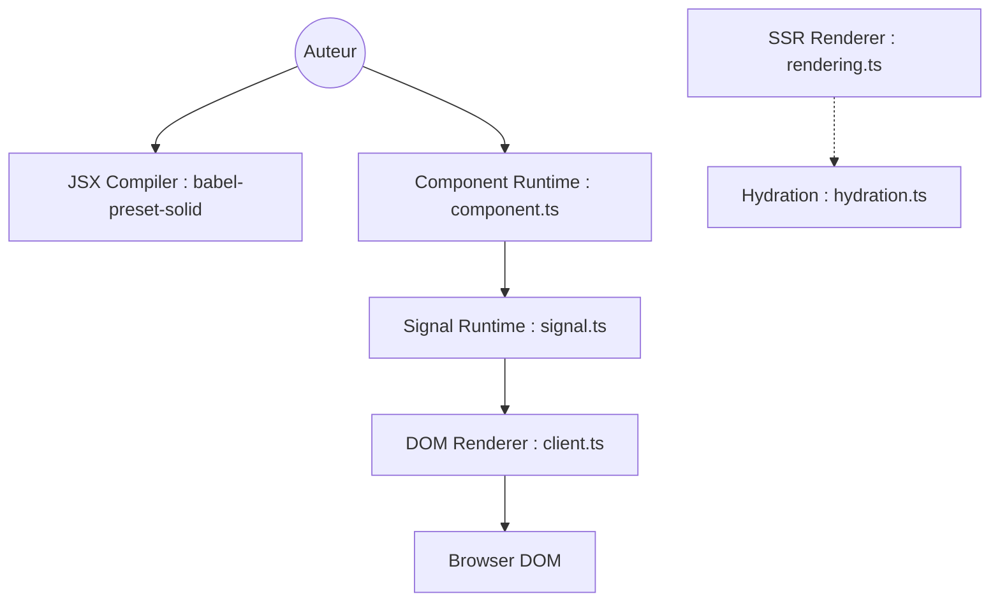

# solidjs/solid

> Declarative JavaScript library for interfaces, which compiles to real DOM nodes with no virtual DOM.

## The problem
Virtual-DOM frameworks recompute entire components even though only one piece of state has changed.

## What it actually does
Components run once. Signals (`createSignal`) track their dependencies and rerun only the code concerned. JSX is compiled to DOM operations. Stores, resources, Suspense, server rendering with hydration, custom elements and universal renderers are provided.

## How it is wired


## Trying it
```bash
npx degit solidjs/templates/js my-app
cd my-app
npm i
npm run dev
```

## Cost and gotchas
Free. Node is required; JSX goes through `babel-preset-solid` and, in TypeScript, `jsx: preserve` with `jsxImportSource: solid-js`.

## What it is not
Not an equivalent of React: components do not rerun, which changes habits. Not a meta-framework: routing and server rendering require tools alongside it.

## Alternatives
No alternative named in the README.

## For you
Ignore on the data / AI side: a UI framework, useful only if you build a web dashboard by hand.
