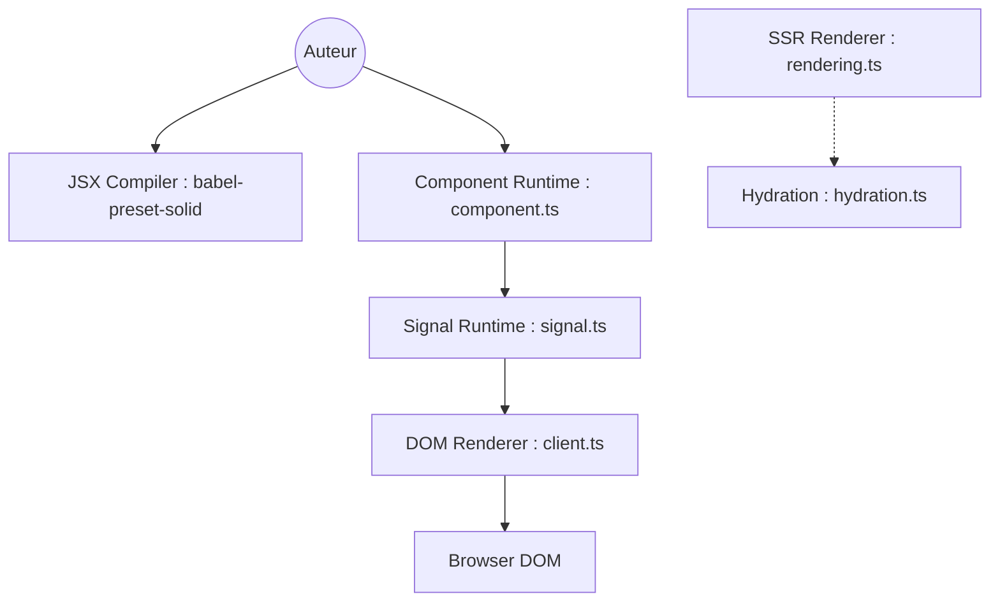

# solidjs/solid

> Bibliothèque JavaScript déclarative pour interfaces, qui compile en vrais nœuds DOM sans DOM virtuel.

## Le problème
Les frameworks à DOM virtuel recalculent des composants entiers, alors qu'un seul morceau d'état a changé.

## Ce que ça fait vraiment
Les composants s'exécutent une fois. Les signaux (`createSignal`) suivent leurs dépendances et ne relancent que le code concerné. Le JSX est compilé en opérations DOM. Stores, ressources, Suspense, rendu serveur avec hydratation, éléments personnalisés et rendus universels sont fournis.

## Comment c'est branché


## Essayer
```bash
npx degit solidjs/templates/js my-app
cd my-app
npm i
npm run dev
```

## Coût et pièges
Gratuit. Il faut Node ; le JSX passe par `babel-preset-solid` et, en TypeScript, `jsx: preserve` avec `jsxImportSource: solid-js`.

## Ce que ce n'est pas
Pas un équivalent de React : les composants ne se réexécutent pas, ce qui change les habitudes. Pas un méta-framework : routage et rendu serveur demandent des outils à côté.

## Alternatives
Aucune alternative nommée dans le README.

## Pour toi
À ignorer côté data / IA : un framework d'interface, utile seulement si tu construis un tableau de bord web à la main.

