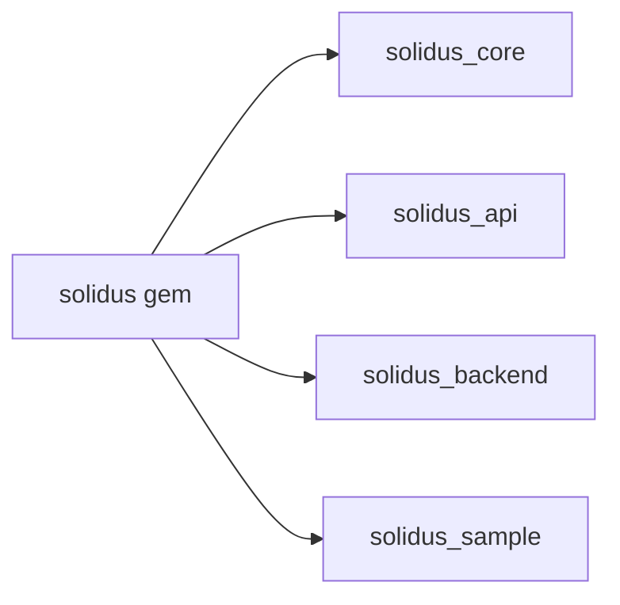

# solidusio/solidus

> Open-source e-commerce platform in Ruby on Rails, a fork of Spree, for shop developers.

## The problem
Building a custom online shop while controlling all the code.

## What it actually does
A set of gems: `solidus_core` (models, mailers), `solidus_api` (REST), `solidus_backend` (admin), `solidus_sample` (data). The `solidus:install` generator (migrations, seeds, samples). Nebulab is the main contributor and director. Extensions are listed on extensions.solidus.io.

## How it is wired


## Trying it
```bash
bin/setup
bin/sandbox
bin/dev
```

## Cost and gotchas
ImageMagick required (Paperclip). Default admin credentials in the docs: change them. The master branch is not guaranteed stable.

## What it is not
Not a ready-to-use SaaS. The README mentions old Rails versions in some examples.

## Alternatives
Spree, of which Solidus is a fork, cited without a comparison.

## For you
Ignore: Rails e-commerce, no link with data/AI.
