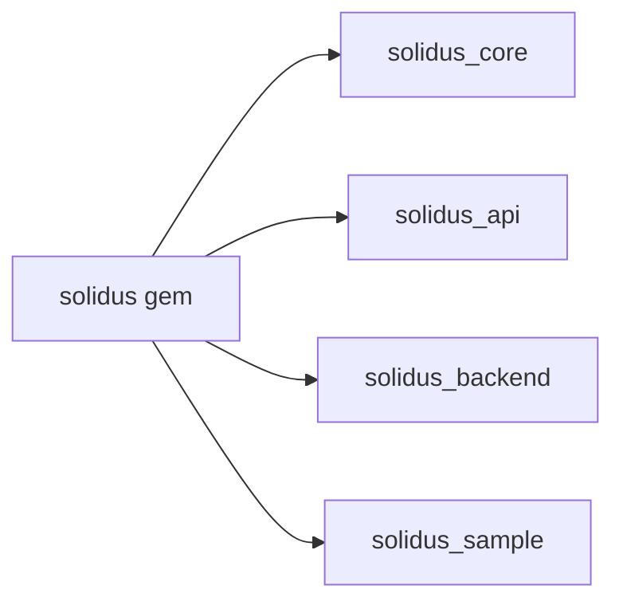

# solidusio/solidus

> Plateforme e-commerce open source en Ruby on Rails, fork de Spree, pour développeurs de boutiques.

## Le problème
Bâtir une boutique en ligne sur mesure en contrôlant tout le code.

## Ce que ça fait vraiment
Ensemble de gems : `solidus_core` (modèles, mailers), `solidus_api` (REST), `solidus_backend` (admin), `solidus_sample` (données). Générateur `solidus:install` (migrations, seeds, exemples). Nebulab en est le principal contributeur et directeur. Extensions listées sur extensions.solidus.io.

## Comment c'est branché


## Essayer
```bash
bin/setup
bin/sandbox
bin/dev
```

## Coût et pièges
ImageMagick requis (Paperclip). Identifiants admin par défaut dans la doc : à changer. La branche master n'est pas garantie stable.

## Ce que ce n'est pas
Pas un SaaS prêt à l'emploi. Le README indique des versions Rails anciennes dans certains exemples.

## Alternatives
Spree, dont Solidus est un fork, cité sans comparatif.

## Pour toi
Ignorer : e-commerce Rails, aucun lien avec le data/IA.

