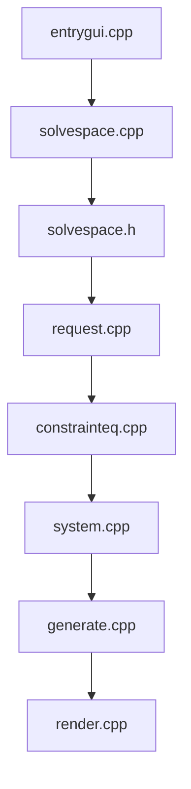

# solvespace/solvespace

> 2D and 3D parametric CAD software for drawing parts using constraints.

## The problem
Changing a dimension in a classic drawing forces you to rework everything by hand. Parametric CAD preserves the design intent.

## What it actually does
SolveSpace turns drawing requests into entities, generates the constraint equations and solves them to update the parameters. It then produces curves, meshes and solids, with boolean operations. It reads and writes `.slvs` files, imports DXF and meshes, and exports to STEP among others. A C API for the solver and Python bindings exist.

## How it is wired


## Trying it
```bash
snap install solvespace
snap install solvespace --edge
git clone https://github.com/solvespace/solvespace
cd solvespace
git submodule update --init
```

## Cost and gotchas
Free. Development versions may be unstable. 64-bit Windows binaries do not support 6-axis mice. The web port is described as very experimental, with critical bugs.

## What it is not
Neither a simulation tool nor a free-form organic modeler: it is a constraint-driven modeler. The web port is not usable in production according to the README.

## Alternatives
No alternative named in the README.

## For you
Ignore: a CAD tool unrelated to data or AI, to keep for technical drawing or 3D printing.
