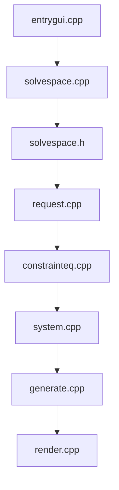

# solvespace/solvespace

> Logiciel de CAO paramétrique 2D et 3D pour dessiner des pièces par contraintes.

## Le problème
Modifier une cote dans un dessin classique oblige à tout retoucher à la main. La CAO paramétrique garde l'intention de conception.

## Ce que ça fait vraiment
SolveSpace transforme les requêtes de dessin en entités, génère les équations de contraintes et les résout pour mettre à jour les paramètres. Il produit ensuite courbes, maillages et solides, avec opérations booléennes. Il lit et écrit des fichiers `.slvs`, importe DXF et maillages, exporte notamment en STEP. Une API C du solveur et des liaisons Python existent.

## Comment c'est branché


## Essayer
```bash
snap install solvespace
snap install solvespace --edge
git clone https://github.com/solvespace/solvespace
cd solvespace
git submodule update --init
```

## Coût et pièges
Gratuit. Les versions de développement peuvent être instables. Les binaires Windows 64 bits ne gèrent pas les souris 6 axes. Le port web est annoncé très expérimental, avec bugs critiques.

## Ce que ce n'est pas
Ce n'est ni un outil de simulation ni un modeleur d'organes de forme libre : c'est un modeleur piloté par contraintes. Le port web n'est pas utilisable en production selon le README.

## Alternatives
Aucune alternative nommée dans le README.

## Pour toi
À ignorer : outil de CAO sans lien avec la data ou l'IA, à garder pour du dessin technique ou de l'impression 3D.

