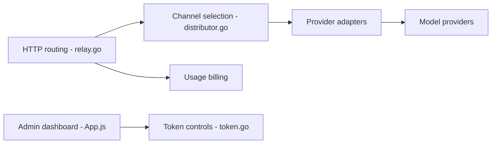

# songquanpeng/one-api

> Single OpenAI-format gateway in front of many LLM providers, with tokens, quotas and billing.

## The problem
Each model provider has its own API, keys and billing; a single, controllable entry point is needed.

## What it actually does
Receives requests in OpenAI format, picks a channel (balancing, retries), adapts the request to the provider (OpenAI, Azure, Claude, Gemini, DeepSeek, Ollama, Chinese models…), returns a compatible streamed response and accounts for consumption. Manages tokens, quotas, groups, top-up codes, logins (email, GitHub, Feishu, WeChat), multi-server with MySQL/Redis.

## How it is wired


## Trying it
```bash
docker run --name one-api -d --restart always -p 3000:3000 -e TZ=Asia/Shanghai -v /home/ubuntu/data/one-api:/data justsong/one-api
docker-compose up -d
```
Initial login `root` / `123456`: change it.

## Cost and gotchas
Model calls remain at your expense. SQLite by default: without a mounted volume, data disappears; in multi-server setups, MySQL is mandatory. Last push on 2026-01-09 (less than a year, no age alert).

## What it is not
Not a model provider. MIT license but the README requires keeping the attribution in the footer, unless authorized. Use is subject to Chinese rules on generative AI.

## Alternatives
No alternative named in the README.

## For you
Worth watching: handy to pool LLM keys in a team, but a project carried by a single person, with a default password and an attribution clause.
