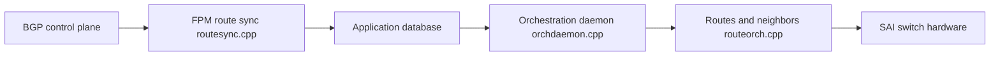

# sonic-net/sonic-swss

> SONiC switch state service, a database layer between network applications and hardware.

## The problem
Network applications and switching hardware must share a consistent state without depending on a particular chip.

## What it actually does
SWSS is a set of daemons that read configuration and routes (FPM/BGP), synchronize links, neighbors, FDB and team interfaces through the Redis databases, then orchestrators push the objects to the hardware through the SAI API. A Rust service collects counters and IPFIX telemetry. Installation goes through Debian packages and a build with autotools.

## How it is wired


## Trying it
```
./autogen.sh
./configure
make && sudo make install
```
Dependencies (`redis-server`, `libhiredis`, `libzmq`, SONiC packages) are installed first, details in the README.

## Cost and gotchas
Free, but installation is heavy: specific Debian packages, dependencies sometimes not found on Ubuntu 20.04, and commands that may remove installed packages. License present but not identified by GitHub. 831 open issues.

## What it is not
Not a complete switch operating system: it is one part of SONiC.

## Alternatives
The README names no alternative.

## For you
Ignore: network switch infrastructure, unrelated to data or AI.
