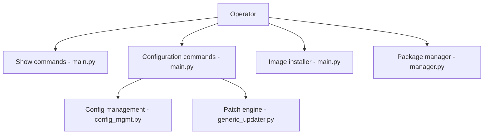

# sonic-net/sonic-utilities

> Command-line tools to configure and inspect SONiC network switches, for network operators.

## The problem
A SONiC switch is driven through its configuration database; without a dedicated CLI, you have to manipulate the databases by hand.

## What it actually does
Repository of two packages: a Python wheel (`sonic-utilities`) with the `show`, `config`, `clear` commands, configuration patch tools, image installation, package management and hardware utilities (transceivers, platform); and a Debian data package (bash completions, Jinja2 templates). It also handles multi-ASIC.

## How it is wired


## Trying it
```bash
make configure PLATFORM=generic
make -f Makefile.work BLDENV=bookworm KEEP_SLAVE_ON=yes target/python-wheels/bookworm/sonic_utilities-1.2-py3-none-any.whl
python3 setup.py bdist_wheel
python3 setup.py test
```

## Cost and gotchas
SONiC dependencies (libyang, swsscommon...) are not on PyPI: you need the `sonic-buildimage` build system in a container. An ICLA is required to contribute. The license is present but not identified by GitHub.

## What it is not
Not usable on its own on an ordinary workstation: it presupposes a SONiC switch. Not a general-purpose networking tool.

## Alternatives
No alternative named in the README.

## For you
Ignore: it only concerns operating SONiC switches, outside the data/AI/MLOps scope.
