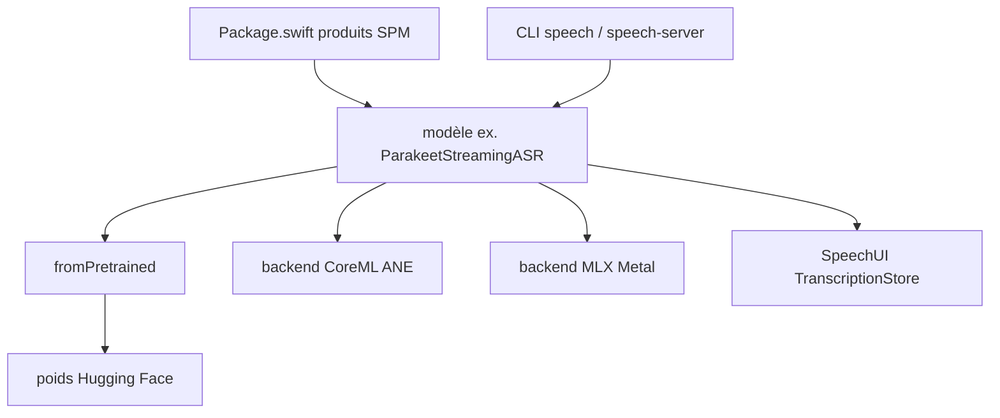

# soniqo/speech-swift

> Collection of speech models run locally on Apple Silicon via MLX Swift and CoreML.

## The problem
Transcribing, synthesizing or diarizing speech almost always goes through a remote API, hence a bill and data leaving your machine.
Assembling several local models requires as many different conversion chains and runtimes.

## What it actually does
Covers nine families: recognition, alignment, synthesis, LLM and translation, speech-to-speech, denoising and restoration, source separation, music generation, turn detection and diarization.
Each model is a separate SPM product — you import only what you use — from `OmnilingualASR` (1,672 languages) to `KokoroTTS` (82 M, Neural Engine) or `SpeechVAD`.
A `speech` CLI exposes transcription, synthesis, translation and voice dialogue, plus an OpenAI-compatible HTTP/WebSocket `speech-server` (`/v1/realtime`, `/v1/audio/transcriptions`).
Minimal SwiftUI views (`TranscriptionView`, `TranscriptionStore`) plug a partial transcription stream in directly.

## How it is wired


## Trying it
```bash
brew install speech
speech transcribe recording.wav
speech speak "Hello world"
speech translate "Hello, how are you?" --to es
speech-server --port 8080
make build
```

## Cost and gotchas
Apple Silicon required, macOS 15+ or iOS 18+, Swift 6 and Xcode 16 with the Metal Toolchain; native ARM Homebrew only.
`make build` also compiles the Metal shader library: without it, `Failed to load the default metallib` at runtime.
`--debug-timeline` can reveal tool arguments: keep it out of shared logs.

## What it is not
Not entirely reusable commercially: F5-TTS is under a non-commercial license and Higgs TTS 3 under a research/non-commercial license — the others vary (MIT, Apache-2.0, CC-BY-4.0).
Not a lightweight library: the catalog ranges from 82 M to 11 B parameters, with very different memory footprints.
`SpeechUI` ships only two components; visualization and audio playback are left to do with AVFoundation.

## Alternatives
No alternative named in the README.

## For you
The catalog to know if you ever have to transcribe without sending the audio out — provided you have an Apple Silicon Mac and sort out the licenses.
